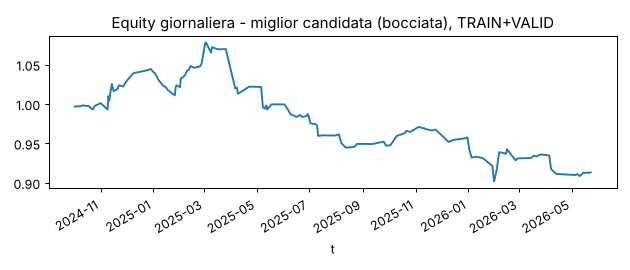

# Intraday Kraken — ❌ NESSUNA STRATEGIA PROMOSSA (TEST non toccato)

| Criterio | Richiesto | Miglior candidata (VWAP-stretch z6, VALID) |
|---|---|---|
| Giornate positive | ≥55% | 48% |
| Profit factor | ≥1,3 | 0,73 |
| Drawdown | ≤20% | 6% (su 4 giorni di trading/sett.) |
| Operazioni | ≥300 | 124 |
| Rendimento | >0 | −5% |

**Costi:** spot Kraken Pro (maker/taker ≈0,25/0,40% al livello base; non verificato sulla pagina dinamica) = 0,8%+ a/r, impossibile intraday. Scelti i **perpetui** (Kraken Futures 0,02% maker / 0,05% taker, valori noti, host futures non raggiungibile). Modello: taker 0,05% + slippage 0,02% per lato = 14 bp a/r.

**Dati (deviazione):** l'OHLC Kraken restituisce solo 720 candele, le trade storiche sono impraticabili. Usate candele 5m Binance spot (proxy), BTC/ETH/SOL/XRP/ADA, ott-2024→ott-2026 (25 mesi), split 60/20/20.

**Esplorazione (TRAIN, orizzonte 1h):** ogni pattern (ora, giorno, sessione, estremi, volume, lead-lag BTC, VWAP, gap vs ieri) ha edge lordo ≤ ~5 bp contro 14 bp di costo: top-10 tutti netti negativi (−9/−12 bp).
**Giri:** 2 (dip-buy, VWAP-reversion, breakout livello di ieri, lead-lag BTC; griglie ≤48 combinazioni). Tutte PF<1 su TRAIN e VALID; il Validatore non è stato nemmeno necessario.

**Regole (migliore, bocciata):** entra alla candela dopo |prezzo/VWAP−1| > 6σ, contro-trend; SL 3 ATR, TP 6 ATR, uscita max 3h e flat a fine giornata UTC; max 10 op/giorno.

Codice: fetch.py, backtest.py, explore.py, giro1.py.
